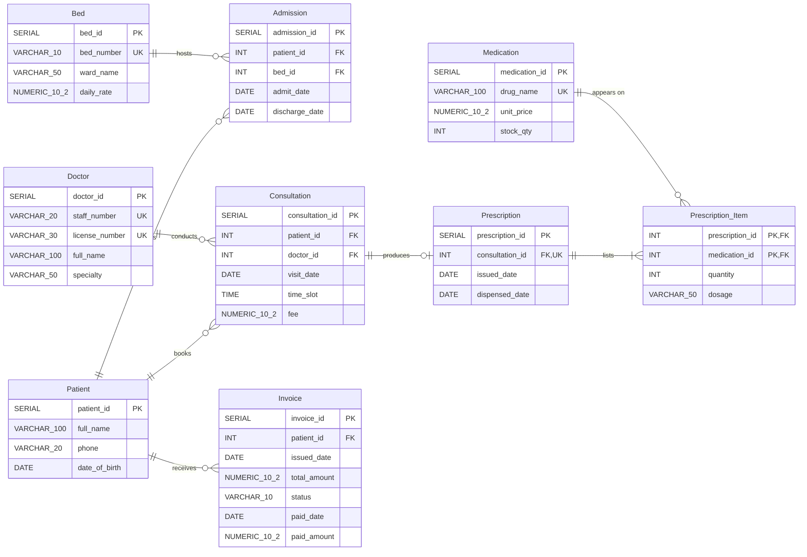

# MIT 8103 Advanced Database Systems: Portfolio Summary

**Case study:** Hospital Management System | **Oduduabasi Id-Victor** | **301932603**  
**Repository:** https://github.com/TedUltimate99/Id-Victor_Oduduabasi_301932603  

## Case study

The Hospital Management System manages outpatient and inpatient operations across a single hospital facility using fictional records. Patients attend consultations, occupy ward beds, receive medications, and pay invoices; receptionists register patients, book consultations, assign ward beds, and settle invoices; doctors conduct consultations, request admissions, and issue prescriptions; and pharmacists dispense medications while updating inventory.

## Portfolio 1: Database Design and Modelling

A normalised relational schema (0NF to 3NF) was designed and implemented in PostgreSQL 16 inside the `hospital_management_portfolio` database. Nine tables (`patient`, `doctor`, `bed`, `medication`, `admission`, `consultation`, `prescription`, `prescription_item`, and `invoice`) were created using `SERIAL` primary keys, foreign keys, `NOT NULL` and `UNIQUE` constraints, `CHECK` constraints for ranges, dates, and invoice settlement, and partial unique indexes (`WHERE discharge_date IS NULL`) on `admission(bed_id)` and `admission(patient_id)`. After loading baseline records, all 13 deliberately invalid `INSERT` statements failed with the expected PostgreSQL errors, leaving verified baseline row counts across all nine tables (`admission`: 2, `bed`: 3, `consultation`: 2, `doctor`: 2, `invoice`: 2, `medication`: 3, `patient`: 3, `prescription`: 2, and `prescription_item`: 3). This confirms that declarative DDL constraints reliably enforce single-table and unique-key rules, whereas cross-table stock checks and one-time dispensing state transitions require transactional logic.

## Portfolio 2: Query Processing and Optimisation

Three operational queries were executed against the baseline database: identifying unpaid invoices (1 row: `invoice_id = 2` for Zainab Ibrahim at `17500.00`), listing available ward beds (2 rows: `CAR-01` and `GEN-02`, excluding occupied `GEN-01`), and counting medication prescription usage (all 3 medications at `1` each via `LEFT JOIN`). Query optimisation was then benchmarked on `p2_benchmark.consultation_history` (100,000 rows, returning 10 matching rows) for a selective filter on `(doctor_id, visit_date)` ordered by `time_slot` before and after creating the composite B-tree index `idx_history_doctor_date_slot` (PostgreSQL Global Development Group, 2023a):

| State | Scan type | Run 1 (ms) | Run 2 (ms) | Run 3 (ms) | Median (ms) | Top-level shared buffer hits (Run 3) |
| :--- | :--- | :--- | :--- | :--- | :--- | :--- |
| **Before index** | Parallel Seq Scan + Sort + Gather Merge | 13.931 | 14.086 | 13.942 | 13.942 | 1509 |
| **After index** | Index Scan (`idx_history_doctor_date_slot`) | 0.057 | 0.052 | 0.063 | 0.057 | 13 |

Adding the composite index eliminated both the full-table scan and in-memory sort, reducing median execution time from 13.942 ms to 0.057 ms and shared buffer hits from 1,509 to 13. However, single-machine Codespace timings vary with CPU load and cache state, and B-tree indexes add storage and write overhead on data modifications.

## Portfolio 3: Transactions and Concurrency

Building on the Portfolio 1 baseline state, atomic transaction control was verified in `psql` under `READ COMMITTED` isolation (PostgreSQL Global Development Group, 2023b). In `Id-Victor_Oduduabasi_301932603_P3_Transactions.sql`, a `BEGIN`–`COMMIT` transaction dispensed `prescription_id = 2` (`dispensed_date = '2026-10-15'`) and reduced `Lisinopril 10mg` stock from `50` to `49` (`UPDATE 1` each), while a repeat `UPDATE` with `WHERE dispensed_date IS NULL` returned `UPDATE 0`, preventing double-dispensing. A second transaction validly settled `invoice_id = 2` (`17500.00`) before an invalid underpayment (`10000.00`) triggered `chk_invoice_settlement`, and `ROLLBACK` reverted `invoice_id = 2` to `Unpaid`. In a concurrent two-session test (`SessionA` and `SessionB`), Session A inserted an uncommitted active admission for Adaeze Nwosu in free bed `GEN-02`; Session B still saw `GEN-02` as unoccupied (preventing dirty reads), blocked on `idx_active_bed_admission`, and failed with a unique constraint error once Session A committed, rolling back so only `admission_id = 7` occupied `GEN-02`.

## Portfolio 4: NoSQL and Advanced Data Models

To evaluate document-oriented modelling alongside PostgreSQL, I stored four standalone fictional activity records (`EVT-2026-001` to `EVT-2026-004`), reusing domain identifiers from the case study, in a single polymorphic MongoDB `8.0.38` collection (`hospital_events`) inside `hospital_management_portfolio` (MongoDB, Inc., 2024a, 2024b). Each document shares `_id`, `event_type`, `occurred_at`, and an embedded `patient` summary, while `details` vary between `ward_admission` and `consultation_visit`. Verification in `mongosh 2.14.2` confirmed an initial count of `0`, batch insertion of `4` documents, chronological retrieval of Adaeze Nwosu's `2` events (`EVT-2026-001` and `EVT-2026-003`) without joins, and nested-field filtering returning `1` pending prescription (`EVT-2026-004` for Zainab Ibrahim) (MongoDB, Inc., 2024c). While document embedding simplifies clinical timeline reads, it introduces controlled data duplication and lacks PostgreSQL's declarative cross-entity constraints.

## Portfolio 5: Distributed and Cloud Database Exercise

The current deployment runs on a single Ubuntu 24.04 Codespace without replication, clustering, or failover testing: PostgreSQL hosts the nine relational tables while a standalone MongoDB `8.0.38` instance runs on `127.0.0.1:27017` using `/workspaces/mongodb-data`. To remove the single point of failure for `hospital_events`, a proposed architecture replaces the standalone node with a three-member voting replica set (`mongo-hosp-1` primary, `mongo-hosp-2` and `mongo-hosp-3` secondaries) across three availability zones (MongoDB, Inc., 2024d). If the primary fails, the remaining nodes elect a new primary after a brief write pause; losing two nodes prevents elections and leaves only reads available (MongoDB, Inc., 2024e). Using `w: "majority"` write concern prevents rollback of acknowledged `consultation_visit` writes, while PostgreSQL remains authoritative for transactional slot, bed, and stock rules (MongoDB, Inc., 2024f). Sharding is unnecessary at this four-document scale, though a managed cloud deployment (such as MongoDB Atlas) would require authentication, TLS and at-rest encryption, network allow lists, automated backups, and ongoing hosting costs without automatically synchronising PostgreSQL (MongoDB, Inc., 2024g, 2024h).

## Evidence

- **Repository root:** https://github.com/TedUltimate99/Id-Victor_Oduduabasi_301932603
- [**Portfolio 1 (Design, DDL, data, constraint tests, and screenshots)**](https://github.com/TedUltimate99/Id-Victor_Oduduabasi_301932603)
- [**Portfolio 2 (Queries, index benchmark, and screenshots)**](https://github.com/TedUltimate99/Id-Victor_Oduduabasi_301932603)
- [**Portfolio 3 (Transactions, concurrency sessions, and screenshots)**](https://github.com/TedUltimate99/Id-Victor_Oduduabasi_301932603)
- [**Portfolio 4 (MongoDB setup, script, and screenshots)**](https://github.com/TedUltimate99/Id-Victor_Oduduabasi_301932603/tree/main/portfolio-4-nosql)
- [**Portfolio 5 (Distributed and cloud exercise)**](https://github.com/TedUltimate99/Id-Victor_Oduduabasi_301932603)

## Individual reflection

I chose the hospital case study because I already understood its domain workflows clearly from the beginning. However, as I began modelling the system, I realised there were many more transactions and operational interactions than I expected. To keep the design manageable and coherent across all five portfolios, I narrowed the scope to ten main components, and I built the schema, queries, concurrency tests, and event documents around them. Through this process, I learned that every entity, constraint, and user role in a database has a specific purpose, and it’s essential not to underestimate any role when maintaining data integrity.

## References

- MongoDB, Inc. (2024a). *MongoDB 8.0 Manual: Data Modelling Concepts.* https://www.mongodb.com/docs/v8.0/core/data-modeling-introduction/
- MongoDB, Inc. (2024b). *MongoDB 8.0 Manual: `db.collection.insertMany()`.* https://www.mongodb.com/docs/v8.0/reference/method/db.collection.insertMany/
- MongoDB, Inc. (2024c). *MongoDB 8.0 Manual: Query on Embedded/Nested Documents.* https://www.mongodb.com/docs/v8.0/tutorial/query-embedded-documents/
- MongoDB, Inc. (2024d). *MongoDB Manual: Replication.* https://www.mongodb.com/docs/manual/replication/
- MongoDB, Inc. (2024e). *MongoDB 8.0 Manual: Replica Set Elections.* https://www.mongodb.com/docs/v8.0/core/replica-set-elections/
- MongoDB, Inc. (2024f). *MongoDB 8.0 Manual: Write Concern.* https://www.mongodb.com/docs/v8.0/reference/write-concern/
- MongoDB, Inc. (2024g). *MongoDB Manual: Sharding.* https://www.mongodb.com/docs/manual/sharding/
- MongoDB, Inc. (2024h). *MongoDB Atlas: Back Up and Restore Clusters.* https://www.mongodb.com/docs/atlas/backup-restore-cluster/
- PostgreSQL Global Development Group. (2023a). *PostgreSQL 16 Documentation: Chapter 11. Indexes and Chapter 14. Performance Tips (Using EXPLAIN).* https://www.postgresql.org/docs/16/indexes.html
- PostgreSQL Global Development Group. (2023b). *PostgreSQL 16 Documentation: Chapter 13. Concurrency Control (Transaction Isolation and Explicit Locking).* https://www.postgresql.org/docs/16/mvcc.html

## AI-use declaration

Gemini served as an assistive tool to help maintain the structure and the organisation of the portfolio documentation. All generated SQL, `mongosh` scripts, and Markdown outputs were thoroughly reviewed and verified. This process included identifying and correcting any syntax errors during testing and execution.