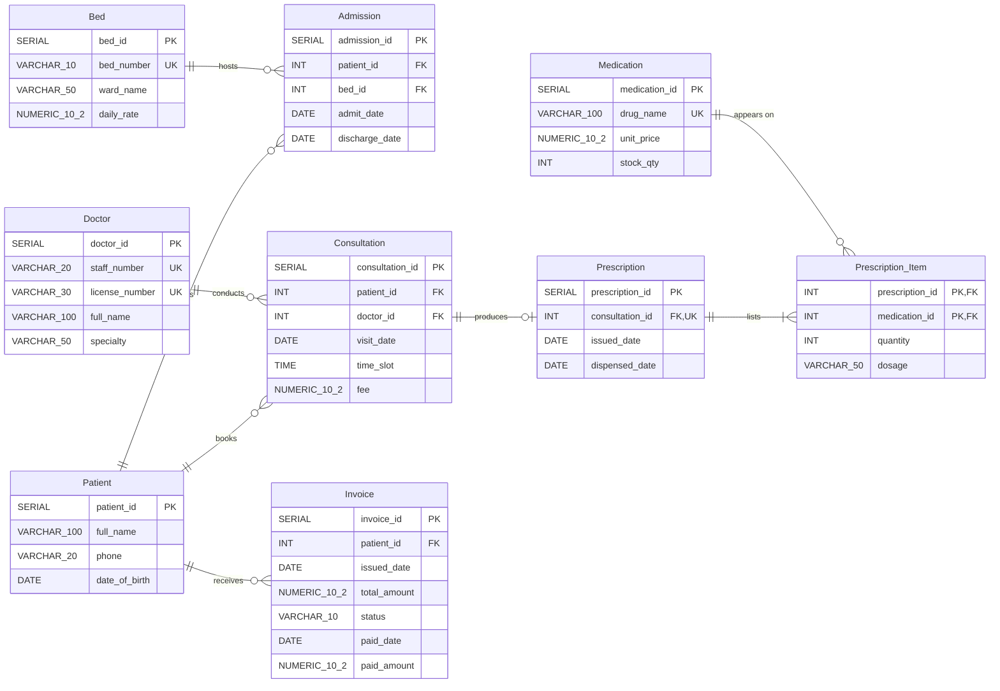

# Hospital Management System ER Diagram

## Key and Relationship Notation
* **PK (Primary Key)**: Uniquely identifies each row in a table (such as `patient_id` in `Patient`). In `Prescription_Item`, `prescription_id` and `medication_id` form a composite primary key so the same medication is not listed twice on one prescription.
* **FK (Foreign Key)**: Links a record to a primary key in another table (such as `Admission.bed_id` referencing `Bed.bed_id`).
* **UK (Unique Key)**: Prevents duplicate values in non-primary columns (such as `Doctor.staff_number`, `Doctor.license_number`, `Bed.bed_number`, `Medication.drug_name`, and `Prescription.consultation_id`).
* **Relationship Symbols**:
  * `||` means **exactly one** record is required on that side of the relationship.
  * `o|` means **zero or one** optional record is allowed.
  * `o{` means **zero or many** records are allowed.
  * `|{` means **one or many** records are required.

## Case Study Example
One `Patient` (`||`) books zero or many `Consultation` records (`o{`), while each `Consultation` belongs to exactly one `Patient`. A single `Consultation` (`||`) produces zero or one `Prescription` (`o|`), which in turn lists one or many `Prescription_Item` rows (`|{`), each referencing one `Medication` (`||`) such as Amoxicillin.

## Optional Fields and Additional Logic
* **Optional Fields**: `Admission.discharge_date` remains `NULL` while an inpatient stay is active; `Prescription.dispensed_date` remains `NULL` until pharmacy dispensing occurs; and `Invoice.paid_date` and `Invoice.paid_amount` remain `NULL` while `status` is `Unpaid`.
* **Additional Constraints and Transaction Logic**: Keys alone cannot enforce every business rule. Partial unique indexes (`WHERE discharge_date IS NULL`) on `Admission(bed_id)` and `Admission(patient_id)` prevent overlapping active admissions (Rules 3 and 4). Composite unique constraints on `Consultation(doctor_id, visit_date, time_slot)` and `Consultation(patient_id, visit_date, time_slot)` prevent double-booking (Rule 5). `CHECK` constraints validate date order, positive quantities, and invoice status alignment (Rules 4, 6, and 9). Finally, a database transaction verifies `Prescription_Item.quantity <= Medication.stock_qty` before reducing stock and setting `dispensed_date` (Rule 7).