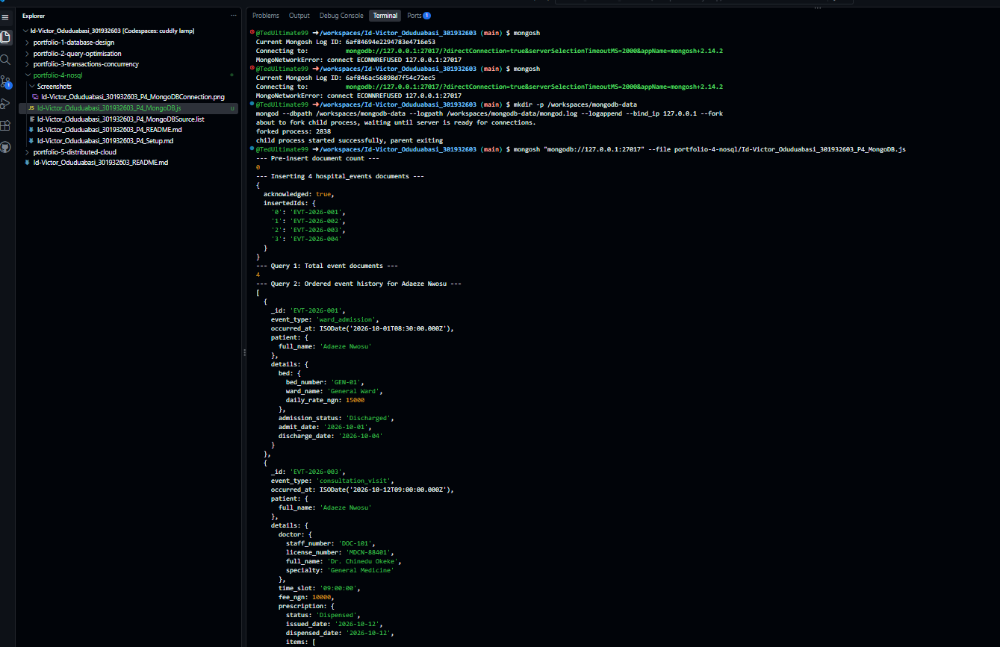
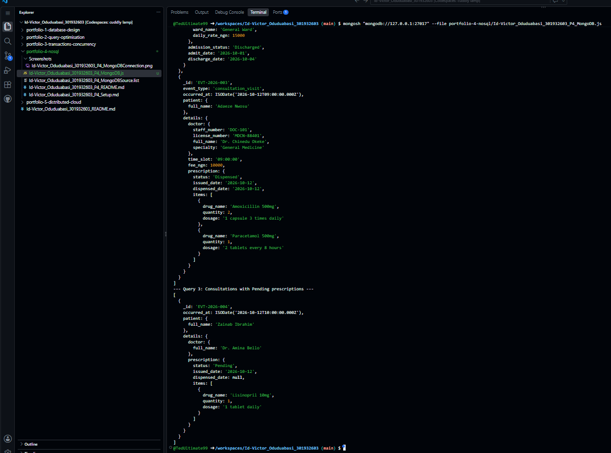

# Portfolio 4 NoSQL and Advanced Data Models

## Document model

To explore document-oriented modeling alongside the normalized PostgreSQL schema for the **Hospital Management System**, clinical activity records are stored in a single polymorphic MongoDB collection named `hospital_events` inside the `hospital_management_portfolio` database.

> **Data Origin Note:** These four documents are standalone, fictional MongoDB activity records created specifically for this NoSQL model. They reuse familiar domain identifiers from the PostgreSQL Hospital Management System case study (such as patient phone numbers, doctor `staff_number` values, ward `bed_number`, and `drug_name` entries) rather than being an automated export or live sync from PostgreSQL.

Every document shares top-level envelope fields (`_id`, `event_type`, `occurred_at`, and an embedded `patient` summary) while its `details` subdocument adapts to the specific clinical event type (`ward_admission` or `consultation_visit`):

| Field | Type | Presence | Purpose |
| :--- | :--- | :--- | :--- |
| `_id` | String | All documents | Unique deterministic event identifier (`EVT-2026-001` to `EVT-2026-004`) |
| `event_type` | String | All documents | Discriminator identifying the clinical event (`ward_admission` or `consultation_visit`) |
| `occurred_at` | ISODate | All documents | Fixed UTC timestamp when the activity occurred |
| `patient` | Object | All documents | Embedded patient summary (`full_name`, `phone`, `date_of_birth`) |
| `details` | Object | All documents | Polymorphic subdocument whose structure varies by `event_type` |
| `details.bed` | Object | `ward_admission` | Embedded ward bed details (`bed_number`, `ward_name`, `daily_rate_ngn`) |
| `details.admission_status` | String | `ward_admission` | Inpatient stay state (`Discharged` or `Active`) |
| `details.admit_date` / `discharge_date` | String / Null | `ward_admission` | Admission date and nullable discharge date |
| `details.doctor` | Object | `consultation_visit` | Embedded doctor summary (`staff_number`, `license_number`, `full_name`, `specialty`) |
| `details.time_slot` / `fee_ngn` | String / Number | `consultation_visit` | Consultation appointment slot and fee in NGN |
| `details.prescription` | Object | `consultation_visit` | Embedded prescription status (`Dispensed` or `Pending`), dates, and `items` array |

### Example document (`consultation_visit`)

```json
{
  "_id": "EVT-2026-003",
  "event_type": "consultation_visit",
  "occurred_at": { "$date": "2026-10-12T09:00:00.000Z" },
  "patient": {
    "full_name": "Adaeze Nwosu",
    "phone": "+234-800-111-0001",
    "date_of_birth": "1990-04-15"
  },
  "details": {
    "doctor": {
      "staff_number": "DOC-101",
      "license_number": "MDCN-88401",
      "full_name": "Dr. Chinedu Okeke",
      "specialty": "General Medicine"
    },
    "time_slot": "09:00:00",
    "fee_ngn": 10000,
    "prescription": {
      "status": "Dispensed",
      "issued_date": "2026-10-12",
      "dispensed_date": "2026-10-12",
      "items": [
        {
          "drug_name": "Amoxicillin 500mg",
          "quantity": 2,
          "dosage": "1 capsule 3 times daily"
        },
        {
          "drug_name": "Paracetamol 500mg",
          "quantity": 1,
          "dosage": "2 tablets every 8 hours"
        }
      ]
    }
  }
}
```

## Implementation and results

The script [`Id-Victor_Oduduabasi_301932603_P4_MongoDB.js`](Id-Victor_Oduduabasi_301932603_P4_MongoDB.js) was executed against the local MongoDB `8.0.38` instance (`mongodb://127.0.0.1:27017`) using `mongosh 2.14.2`:

```bash
mongosh "mongodb://127.0.0.1:27017" --file portfolio-4-nosql/Id-Victor_Oduduabasi_301932603_P4_MongoDB.js
```

### Actual execution results

* **Pre-insert verification (`db.hospital_events.countDocuments({})`):** Returned `0`, confirming the collection started empty.
* **Batch insertion (`insertMany`):** Returned `acknowledged: true` and inserted four documents with IDs `EVT-2026-001`, `EVT-2026-002`, `EVT-2026-003`, and `EVT-2026-004`.
* **Query 1 — Total event count (`db.hospital_events.countDocuments({})`):** Returned `4`.
* **Query 2 — Ordered patient event history (`{ "patient.phone": "+234-800-111-0001" }` sorted by `occurred_at: 1`):** Returned **2 documents** for **Adaeze Nwosu** in chronological order:
  1. `EVT-2026-001` (`ward_admission` on `2026-10-01T08:30:00.000Z`, General Ward bed `GEN-01`, status `Discharged` on `2026-10-04`).
  2. `EVT-2026-003` (`consultation_visit` on `2026-10-12T09:00:00.000Z` with `Dr. Chinedu Okeke`, `Dispensed` prescription for `Amoxicillin 500mg` and `Paracetamol 500mg`).
* **Query 3 — Nested-field filter (`{ "details.prescription.status": "Pending" }`):** Returned **1 document** (`EVT-2026-004` on `2026-10-12T10:00:00.000Z` for patient **Zainab Ibrahim** with **Dr. Amina Bello**, containing a pending prescription for `Lisinopril 10mg`).





## Why MongoDB fits

* **Suitability for heterogeneous clinical timelines:** In the relational schema, reconstructing a single patient's complete care timeline requires joining `patient`, `admission`, `bed`, `consultation`, `doctor`, `prescription`, `prescription_item`, and `medication`. Storing `ward_admission` and `consultation_visit` records in a single `hospital_events` collection with embedded patient, doctor, bed, and prescription-item subdocuments lets MongoDB retrieve a patient's chronological history or filter pending pharmacy orders in a single read without multi-table joins.
* **Limitation compared to PostgreSQL:** Embedding repeated master data (such as patient phone numbers, doctor credentials, and bed rates) introduces controlled duplication and lacks cross-document relational constraints. Operational rules from the relational schema—such as preventing double-booked doctor/patient time slots, enforcing one active admission per bed via partial unique indexes, and atomically decrementing `medication.stock_qty` upon dispensing—require explicit application logic or multi-document transactions rather than declarative database-level foreign keys and check constraints.

## Files

* [`Id-Victor_Oduduabasi_301932603_P4_Setup.md`](Id-Victor_Oduduabasi_301932603_P4_Setup.md) — Local MongoDB 8.0.38 installation, data directory configuration, and connection verification guide.
* [`Id-Victor_Oduduabasi_301932603_P4_MongoDB.js`](Id-Victor_Oduduabasi_301932603_P4_MongoDB.js) — `mongosh` script containing the pre-insert count check, `insertMany` batch of four hospital activity events, and three verification queries.
* [`Id-Victor_Oduduabasi_301932603_P4_MongoDBSource.list`](Id-Victor_Oduduabasi_301932603_P4_MongoDBSource.list) — Official MongoDB 8.0 APT repository configuration used during setup.
* [`Screenshots/Id-Victor_Oduduabasi_301932603_P4_MongoDBConnection.png`](Screenshots/Id-Victor_Oduduabasi_301932603_P4_MongoDBConnection.png) — Screenshot confirming `mongosh` connection (`db.version()` and `ping`).
* [`Screenshots/Id-Victor_Oduduabasi_301932603_P4_EventsAndQueries1.png`](Screenshots/Id-Victor_Oduduabasi_301932603_P4_EventsAndQueries1.png) — Screenshot showing pre-insert count, `insertMany` acknowledgment, and initial query output.
* [`Screenshots/Id-Victor_Oduduabasi_301932603_P4_EventsAndQueries2.png`](Screenshots/Id-Victor_Oduduabasi_301932603_P4_EventsAndQueries2.png) — Screenshot showing remaining query results for patient history and pending prescriptions.

## References

* [MongoDB Manual — Data Modeling Concepts](https://www.mongodb.com/docs/v8.0/core/data-modeling-introduction/)
* [MongoDB Manual — `db.collection.insertMany()`](https://www.mongodb.com/docs/v8.0/reference/method/db.collection.insertMany/)
* [MongoDB Manual — Query on Embedded/Nested Documents](https://www.mongodb.com/docs/v8.0/tutorial/query-embedded-documents/)