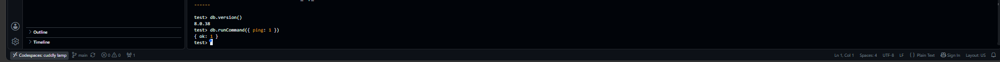

# MongoDB setup

MongoDB runs in the existing Ubuntu 24.04 Codespace (`/workspaces/Id-Victor_Oduduabasi_301932603`), alongside PostgreSQL. The server version is 8.0.38 (`mongosh` 2.14.2). Its data folder is `/workspaces/mongodb-data`, outside the Git repository. Connections use `127.0.0.1`; port forwarding is off.

## Start and connect

```bash
mkdir -p /workspaces/mongodb-data
mongod --dbpath /workspaces/mongodb-data --logpath /workspaces/mongodb-data/mongod.log --logappend --bind_ip 127.0.0.1 --fork
mongosh "mongodb://127.0.0.1:27017"
```

## Connection check

`db.version()` returns `8.0.38` and `db.runCommand({ ping: 1 })` returns `{ ok: 1 }`.



## Reference

* [MongoDB Ubuntu installation guide](https://www.mongodb.com/docs/v8.0/tutorial/install-mongodb-on-ubuntu/)